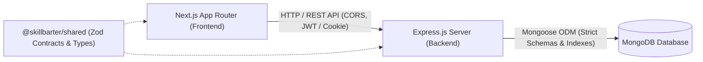

# SkillBarter-Next Architecture

## 1. System Overview

SkillBarter-Next is a peer-to-peer skill exchange platform designed as a clean monorepo with strict architectural boundaries. The platform operates on a reciprocal model where users teach what they know in return for learning desired skills.

---

## 2. Workspace Domains & Responsibilities

### Frontend (`/frontend`)
- Built with **Next.js 15 (App Router)** and **React 19**.
- Type-safe centralized API service client (`src/services/api.ts`).
- React Context Authentication state (`src/context/AuthContext.tsx`) with automatic token refresh and session persistence.
- Complete responsive views: Landing, Dashboard, Onboarding, Discover matching, Exchanges, Sessions, Messaging, Notifications, Reviews, Connections, Community Feed, Settings, Safety & Reporting, and Admin Governance.

### Backend (`/backend`)
- Built with **Node.js, Express.js, TypeScript**.
- Centralized error handler with `AppError`, Zod validation formatting, and generic errors for auth safety.
- Request logger with automatic redaction of passwords, tokens, and authorization headers.
- Modular domain pattern:
  - `auth`: Registration, Argon2id hashing, JWT access/refresh token signing, email verification, password recovery.
  - `users`: Profile viewing, profile editing with strict field whitelisting, and multi-step onboarding.
  - `skills`: Canonical skill taxonomy catalog and user skill associations (`offered` / `wanted`).
  - `matches`: Deterministic matching engine computing reciprocal compatibility percentages and clear explanations.
  - `exchanges`: Complete exchange state machine (`DRAFT`, `PENDING`, `ACCEPTED`, `REJECTED`, `SCHEDULED`, `IN_PROGRESS`, `COMPLETED`, `CANCELLED`, `DISPUTED`).
  - `sessions`: Conflict-free session proposal, confirmation, rescheduling, and cancellation.
  - `messages`: Private two-party conversation threads with participant authorization and unread counts.
  - `notifications`: Persistent in-app activity notifications.
  - `reviews`: Star ratings (1-5) and written feedback with automated reputation score calculation.
  - `community`: Peer connection network and public learning advice feed.
  - `safety`: Two-way user blocking and moderation reports for accounts, messages, and posts.
  - `admin`: Role-based protected administration for platform statistics, user suspension, moderation review, and audit trail.
  - `analytics`: Privacy-conscious event recording without sensitive credential exposure.

### Shared (`/shared`)
- Canonical types and Zod schemas shared between frontend and backend to guarantee end-to-end contract synchronization.

---

## 3. Data Integrity & Security Standards

1. **Passwords**: Hashed with **Argon2id** (memory cost: 64MB, time cost: 3 iterations).
2. **Authentication**: Short-lived JWT access tokens and rotatable refresh tokens stored in secure, HTTP-only cookies and Authorization headers.
3. **No Mass Assignment**: Updates to user profiles explicitly whitelist allowable fields; client-provided roles, account statuses, and reputation scores are rejected.
4. **Information Exposure**: Readiness and health endpoints never reveal MongoDB connection strings, database credentials, or stack traces in production.
5. **Separation of Environments**: Production, local development, and automated test databases are strictly separated; automated tests run against an isolated in-memory MongoDB server.
