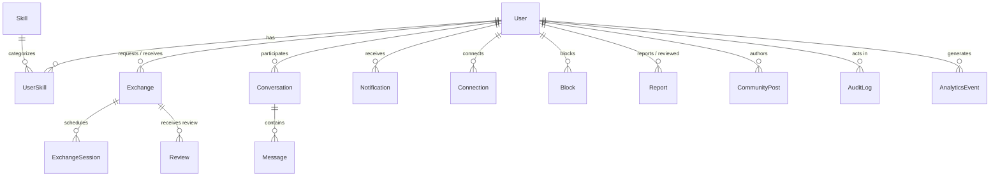

# SkillBarter-Next Database Design

MongoDB is the primary persistence engine, accessed exclusively from the backend via **Mongoose**.

## 1. Entity-Relationship Architecture

---

## 2. Model Schemas & Indexing Strategy

### 1. `User`
- **Fields**: `email` (string, unique, lowercase), `passwordHash` (Argon2id string), `displayName` (string), `role` (`"user" | "admin"`), `isEmailVerified` (boolean), `verificationToken` (string), `verificationTokenExpiresAt` (Date), `passwordResetToken` (string), `passwordResetExpiresAt` (Date), `bio` (string), `location` (string), `avatarUrl` (string), `preferredSessionFormat` (`"video" | "chat" | "in_person" | "any"`), `availability` (string), `isProfilePublic` (boolean), `onboardingCompleted` (boolean), `reputationScore` (number, default 5.0), `completedExchangesCount` (number, default 0), `isSuspended` (boolean), `suspensionReason` (string).
- **Indexes**:
  - `email`: Unique index for fast credential lookup.
  - `role`: Filter index for administrative queries.
  - `reputationScore`: Secondary index for ranking discover matches.

### 2. `Skill`
- **Fields**: `name` (string), `normalizedName` (string, lowercase unique), `category` (string), `description` (string), `approved` (boolean), `createdBy` (ref `User`).
- **Indexes**:
  - `normalizedName`: Unique index to prevent duplicate skill terms (e.g., "Python" and "python").
  - `category`: Fast category filtering.

### 3. `UserSkill`
- **Fields**: `userId` (ref `User`), `skillId` (ref `Skill`), `skillName` (string), `category` (string), `type` (`"offered" | "wanted"`), `proficiency` (`"beginner" | "intermediate" | "advanced" | "expert"`), `description` (string), `yearsExperience` (number).
- **Compound Index**:
  - `{ userId: 1, skillId: 1, type: 1 }`: Unique compound index ensuring a user cannot add duplicate associations for the same skill and type.

### 4. `Exchange`
- **Fields**: `requesterId` (ref `User`), `recipientId` (ref `User`), `offeredSkillId` (ref `Skill`), `wantedSkillId` (ref `Skill`), `status` (`"DRAFT" | "PENDING" | "ACCEPTED" | "REJECTED" | "SCHEDULED" | "IN_PROGRESS" | "COMPLETED" | "CANCELLED" | "DISPUTED"`), `proposalDescription` (string), `cancellationReason` (string), `disputeReason` (string), `completionStatus` (`{ requesterConfirmed: boolean, recipientConfirmed: boolean }`).
- **Indexes**:
  - `requesterId`, `recipientId`: Fast lookup of user exchanges.
  - `status`: Lifecycle filtering.
  - Compound: `{ requesterId: 1, recipientId: 1, status: 1 }`.

### 5. `ExchangeSession`
- **Fields**: `exchangeId` (ref `Exchange`), `proposedById` (ref `User`), `title` (string), `startTime` (Date), `endTime` (Date), `status` (`"PROPOSED" | "CONFIRMED" | "CANCELLED" | "COMPLETED"`), `notes` (string), `meetingLink` (string).
- **Indexes**:
  - `exchangeId`: Sessions lookup per exchange.
  - `startTime`: Chronological ordering and conflict detection.

### 6. `Conversation`
- **Fields**: `participants` (`[ref User]`), `exchangeId` (ref `Exchange`), `lastMessageAt` (Date), `lastMessageText` (string), `lastMessageSenderId` (ref `User`).
- **Indexes**:
  - `participants`: Multi-key index to find conversations for a user.
  - `lastMessageAt`: Chronological inbox sorting.

### 7. `Message`
- **Fields**: `conversationId` (ref `Conversation`), `senderId` (ref `User`), `content` (string, max 2000 chars), `readBy` (`[ref User]`).
- **Compound Index**:
  - `{ conversationId: 1, createdAt: 1 }`: Fast message thread retrieval.

### 8. `Notification`
- **Fields**: `recipientId` (ref `User`), `senderId` (ref `User`), `type` (string), `title` (string), `message` (string), `link` (string), `read` (boolean, default false).
- **Compound Index**:
  - `{ recipientId: 1, read: 1, createdAt: -1 }`: Fast unread count and unread notification queries.

### 9. `Review`
- **Fields**: `exchangeId` (ref `Exchange`), `reviewerId` (ref `User`), `revieweeId` (ref `User`), `rating` (number, 1-5), `comment` (string).
- **Compound Index**:
  - `{ exchangeId: 1, reviewerId: 1 }`: Unique constraint preventing multiple reviews from the same user for the same exchange.

### 10. `Connection`
- **Fields**: `requesterId` (ref `User`), `recipientId` (ref `User`), `status` (`"PENDING" | "ACCEPTED" | "REJECTED"`).
- **Compound Index**:
  - `{ requesterId: 1, recipientId: 1 }`: Unique constraint preventing duplicate connection requests.

### 11. `Block`
- **Fields**: `blockerId` (ref `User`), `blockedUserId` (ref `User`), `reason` (string), `createdAt` (Date).
- **Compound Index**:
  - `{ blockerId: 1, blockedUserId: 1 }`: Unique constraint.

### 12. `Report`
- **Fields**: `reporterId` (ref `User`), `targetType` (`"user" | "message" | "review" | "community_post"`), `targetId` (string), `reason` (string), `description` (string), `status` (`"PENDING" | "REVIEWED" | "RESOLVED" | "DISMISSED"`), `resolvedById` (ref `User`), `moderationNotes` (string).
- **Indexes**: `reporterId`, `status`, `targetType`.

### 13. `CommunityPost`
- **Fields**: `authorId` (ref `User`), `title` (string), `content` (string), `tags` (`[string]`), `likesCount` (number).
- **Index**: `{ createdAt: -1 }`.

### 14. `AnalyticsEvent`
- **Fields**: `eventName` (string), `userId` (ref `User`), `metadata` (Mixed), `timestamp` (Date).
- **Indexes**: `eventName`, `timestamp`, `userId`.

### 15. `AuditLog`
- **Fields**: `actorId` (ref `User`), `action` (string), `targetType` (string), `targetId` (string), `details` (Mixed), `ipAddress` (string), `timestamp` (Date).
- **Indexes**: `actorId`, `action`, `timestamp`.
